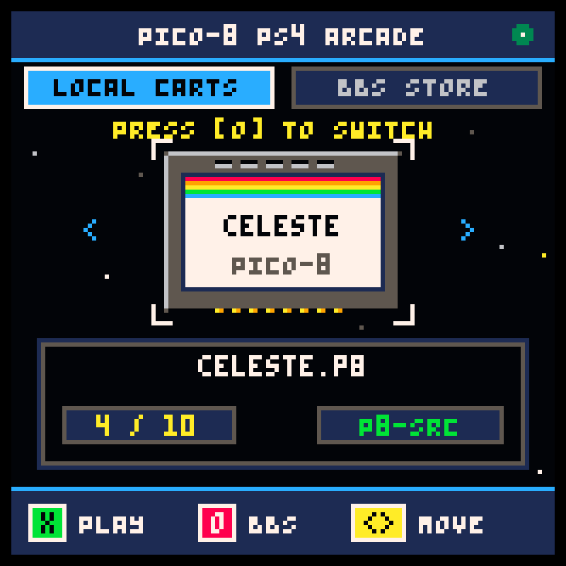
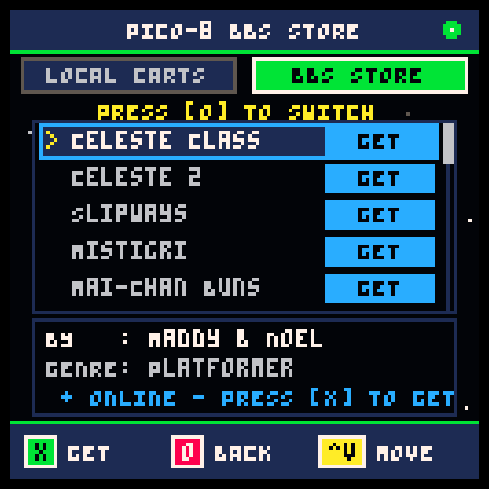
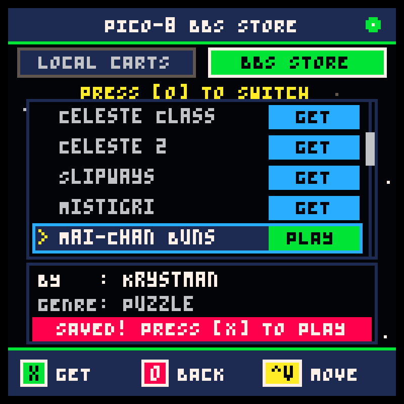

# PICO-8 PS4 🎮
**A Native PICO-8 Fantasy Console Player & Arcade for PlayStation 4**

[](https://github.com/birth1mark/pico8-ps4/releases/latest)
[](https://github.com/OpenOrbis)
[](https://github.com/OpenOrbis/OpenOrbis-PS4-Toolchain)
[](LICENSE.MD)
[](https://github.com/birth1mark/pico8-ps4/releases)

**PICO-8 PS4** brings the magical world of PICO-8 indie retrogaming natively to the PlayStation 4. Powered by an optimized C++ SDL2 engine, it delivers pixel-perfect 60 FPS gameplay, full DualShock 4 controller integration, an in-app BBS Store to download cartridges on-the-fly, and an out-of-the-box arcade experience with celebrated community titles like *Celeste Classic*.

---

## 📸 Screenshots

| 🕹️ **PICO-8 PS4 Arcade Carousel** | 🌐 **In-App Lexaloffle BBS Store** |
| :---: | :---: |
|  |  |
| ⚡ **1-Click Download & Launch** | 🍓 **Pixel-Perfect 60 FPS Gameplay** |
|  |  |

---

## 🚀 Quick Install (PlayStation 4 PKG)

Pre-built packages are ready to install on any jailbroken PlayStation 4 running firmware **5.05 up to 11.00+** (GoldHEN / Mira / HEN):

### 📥 1. Download the PKG
* **Pre-built Releases:** Download the latest `pico8-ps4.pkg` directly from the [**GitHub Releases**](https://github.com/birth1mark/pico8-ps4/releases) page.
* **Or Build It Locally:** Run `make pkg` to generate `pico8-ps4.pkg` in the project root in seconds.

### 🕹️ 2. Step-by-Step PS4 Installation
1. Format a USB flash drive as **exFAT** or **FAT32**.
2. Copy `pico8-ps4.pkg` directly to the root of your USB drive (e.g. `X:\pico8-ps4.pkg`).
3. Insert the USB drive into your PS4.
4. On your PS4 (with **GoldHEN** or **HEN** enabled), navigate to:
   * **Settings** ➔ **GoldHEN** ➔ **Package Installer**
   *(or **Settings** ➔ **Debug Settings** ➔ **Game** ➔ **Package Installer**)*
5. Select `pico8-ps4.pkg` and press **Cross (✕)** to install.
6. Launch **PICO-8 PS4** from the PS4 Home Screen (XMB) and start playing!

---

## ✨ Features

- **In-App Lexaloffle BBS Store:** Browse, search and download community cartridges directly inside the application with 1-click download & play!
- **Native 1080p Output:** Crisp integer scaling with selectable aspect ratios.
- **Full DualShock 4 Integration:** Seamless mapping for D-Pad, Left Analog Stick, Face Buttons, and tactile controls.
- **Plug-and-Play USB Loading:** Automatically scans and launches `.p8` and `.p8.png` cartridges from USB drives (`/mnt/usb0/pico8/`).
- **Starter Classics Included:** Ships pre-bundled with open-source masterpieces ready to play without configuration.
- **Persistent Save States:** Cartridge data and high scores automatically save to `/data/pico8-ps4/cdata/`.
- **Homebrew Store / PKG-Zone Compliant:** Built 100% clean-room with the community OpenOrbis toolchain (no copyrighted Sony SDK components).

---

## 🕹️ Controls (DualShock 4)

| DualShock 4 Button | PICO-8 Virtual Input | Function |
| :--- | :--- | :--- |
| **D-Pad / Left Stick** | `Left / Right / Up / Down` | Directional Movement |
| **Cross (✕)** | `🅾 (Button 4 / Action 1)` | Jump / Primary Action |
| **Circle (◯)** | `❎ (Button 5 / Action 2)` | Dash / Secondary Action |
| **Square (▢)** | `❎ (Alternate)` | Secondary Action |
| **Triangle (△)** | *Toggle Scaling* | Switch between Pixel-Perfect and Stretched 16:9 |
| **Options** | `Pause / Menu` | In-game PICO-8 Menu |
| **L1 + R1 + Options** | *Exit* | Quick Exit back to PS4 Home Screen |

---

## 📁 Loading Your Own Cartridges

You can easily add new PICO-8 cartridges using any of the following methods:

1. **In-App Lexaloffle BBS Store (Recommended):**
   Press **Circle (◯)** in the arcade menu to switch to the **🌐 BBS Store**! Browse curated community games (*Celeste 2*, *Slipways*, *Mistigri*, *Mai-Chan*, *Hellspawn*, *Dank Tomb*, etc.) or enter any custom cart ID. Press **Cross (✕)** to download and play immediately!

2. **USB Drive:**
   Create a folder named `pico8` on the root of your USB flash drive:
   ```text
   USB Drive -> /pico8/my_game.p8.png
   ```
   Plug it into your PS4. **PICO-8 PS4** will detect and index your carts immediately!

3. **Internal PS4 Storage (FTP):**
   Copy your `.p8` or `.p8.png` files to:
   ```text
   /data/pico8-ps4/carts/
   ```

---

## 🛠️ Building from Source

**PICO-8 PS4** features an automated dual-target build system: test locally on your PC/Linux desktop in seconds, or cross-compile and package for PS4 with a single command.

### 1. Local Desktop Build (Linux / EndeavourOS)
Requires `g++`, `SDL2`, and `libcurl`:
```bash
# Compile and run on your desktop
make desktop
./platform/SDL2Desktop/FAKE08
```

### 2. PS4 Executable (`eboot.bin`)
Requires the [OpenOrbis PS4 Toolchain](https://github.com/OpenOrbis/OpenOrbis-PS4-Toolchain) installed:
```bash
# Cross-compiles C++ sources, links FreeBSD 12 ELF, and signs eboot.bin
make ps4
```
Generates `platform/ps4/eboot.bin` and stages it in `pkg/eboot.bin`.

### 3. PS4 Fake PKG (`pico8-ps4.pkg`)
Builds the complete installable Fake PKG image with starter games and assets in one step:
```bash
make pkg
```
This automatically compiles the code, creates `eboot.bin`, synthesizes `param.sfo` (`PICO00008`) and `icon0.png`, bundles starter carts, signs PlayGo digests, and seals `pico8-ps4.pkg` in the project root.

---

## 📜 Credits & Attributions

This project stands on the shoulders of brilliant creators and open-source contributors:

- **PICO-8 PS4 Port & Development:** **birth1mark**
- **Core Emulator Engine:** [FAKE-08](https://github.com/jtothebell/fake-08) by **jtothebell** (MIT License).
- **PlayStation 4 Toolchain:** [OpenOrbis PS4 Toolchain](https://github.com/OpenOrbis/OpenOrbis-PS4-Toolchain) community developers.
- **PICO-8 Platform & Virtual Architecture:** [Lexaloffle Games](https://www.lexaloffle.com/) (Joseph White / zep).
- **Included Starter Games:**
  - *Celeste Classic* (v8) & *Celeste 2: Lani's Trek* by **Maddy Thorson** and **Noel Berry** (Creative Commons).
  - *Astero* by **Alex Morris** (Open Source).
- **Embedded Libraries:**
  - *z8lua* / Lua runtime adapted by **jtothebell**
  - *LodePNG* by **Lode Vandevenne**
  - *miniz* by **Rich Geldreich** / contributors
  - *SimpleIni* by **Brodie Thiesfield**
  - *SDL2* by the **Simple DirectMedia Layer** team
